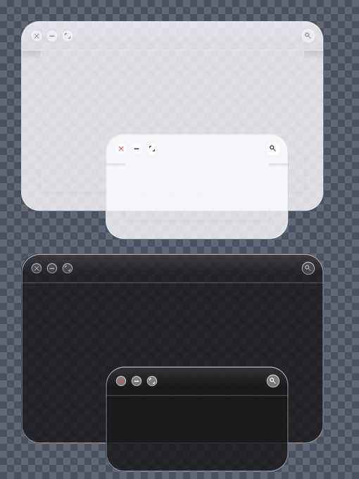
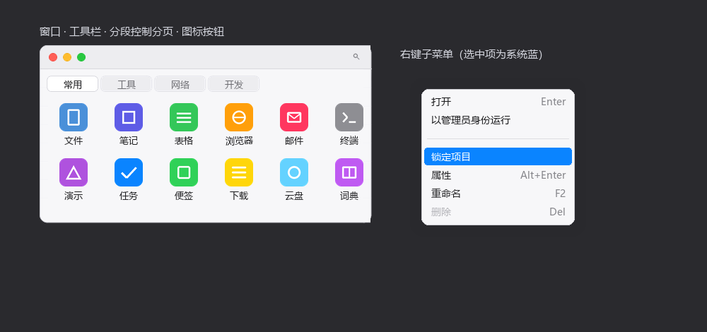

# CLaunch Skins

[](http://pyonkichi.g1.xrea.com/en/claunch.html)
[](LICENSE)

给 Windows 快速启动器 [CLaunch](http://pyonkichi.g1.xrea.com/en/claunch.html) 做的两套皮肤：
**macOS Sonoma**（拟物浅色）与 **Liquid Glass**（iPhone 液态玻璃，浅色 / 深色两变体）。

---

## ① Liquid Glass — iPhone 液态玻璃风格



半透明磨砂玻璃质感 + 高光描边，模拟 iOS 26 液态玻璃（CLaunch 无法实时模糊桌面，
用均匀半透明填充 + 镜面边缘近似）。

- **大圆角 26px 玻璃面板**，整体半透明，桌面隐约透出
- **交通灯布局**：× − ⤢ 圆钮，悬停显示对应字形（关闭钮悬停变红）
- **搜索放大镜**常驻标题栏右侧
- **子菜单 / 搜索结果窗口**同为玻璃面板，选中项 iOS 蓝
- 两个变体：**Liquid Glass**（浅色）与 **Liquid Glass Dark**（深色）
- XML 结构已与官方 `Glass.zip` 逐块比对，**完全等价**（161 个元素，含 `searchwindow`）

### 安装

> ⚠️ CLaunch 4.x 的皮肤是 **zip 直放**，不要解压。

1. 下载 [`Liquid Glass.zip`](Liquid%20Glass.zip) 或 [`Liquid Glass Dark.zip`](Liquid%20Glass%20Dark.zip)
2. 整个复制到 CLaunch 安装目录下的 `Skins\`（注意是复数）：
   `C:\Program Files\CLaunch\Skins\`
3. 重启 CLaunch（皮肤列表在启动时扫描）
4. 面板上右键 → **选项** → **外观** → 选择 **Liquid Glass** / **Liquid Glass Dark**
5. 建议点同一对话框里的 **「应用推荐设置」**

---

## ② macOS Sonoma — mac 拟物风格



- **圆角 11px 窗口**，浅灰工具栏 + 发丝分隔线，主体 `#F7F7F9`
- **左上角三个圆钮**：关闭（红）/ 锁定（黄）/ 模式切换（绿），鼠标滑过显示 mac 字形（×、−、⤢）
- **分页为分段控制器胶囊**，选中页白色，未选中页浅灰
- **图标按钮常规无底色**，滑过显示浅灰圆角块，文字转系统蓝
- **右键子菜单**：选中项为 macOS 系统蓝 `#0A84FF` 白字
- 交互式浏览器预览：[`preview.html`](preview.html)

### 安装

1. 下载 [`macOS Sonoma.zip`](macOS%20Sonoma.zip)，整个复制到 `C:\Program Files\CLaunch\Skins\`
2. 重启 CLaunch → 右键 → 选项 → 外观 → 选择 **macOS Sonoma**
3. 建议点 **「应用推荐设置」**

---

## 要求

| 项目 | 说明 |
|---|---|
| CLaunch | 4.20 或更高（Unicode 版），已在 4.23 上按官方皮肤结构对齐 |
| 显示色深 | 32bpp（Windows 默认即是） |

## 目录结构

```
macOS Sonoma.zip              安装包（zip 根目录即 skin.xml + 部件图）
Liquid Glass.zip              安装包（浅色）
Liquid Glass Dark.zip         安装包（深色）
src/                          皮肤源文件（同 zip 内容，方便直接查看 / 修改）
tools/                        构建脚本（Pillow，4 倍超采样 + LANCZOS 缩小）
  build_skin.py                 macOS Sonoma 部件图
  build_xml.py                  macOS Sonoma skin.xml + 打包
  build_liquid_glass.py         Liquid Glass 两变体全部部件 + skin.xml + 打包
  verify_liquid_glass.py        XML 结构比对官方 Glass.zip + 9 宫格实拼验证
  verify_render.py              macOS Sonoma 渲染验证
  make_hero.py                  README 预览图
preview.html                  macOS Sonoma 浏览器交互预览
```

## 自己改

部件图全部由 `tools/` 里的脚本从零绘制，改色值重跑即可：

```bash
python tools/build_liquid_glass.py   # 重画 Liquid Glass 两变体并重新打包
python tools/build_skin.py           # 重画 macOS Sonoma 部件图
python tools/build_xml.py            # 重写 macOS Sonoma skin.xml 并打包
python tools/verify_liquid_glass.py  # 结构比对 + 渲染验证
```

配色集中在脚本顶部的调色板区块（`build_liquid_glass.py` 的 `PALETTES`，
一个字典同时产出浅色与深色）；字体在各生成脚本的 `FONT` 变量。
`skin.xml` 是 **UTF-16 LE 带 BOM**，手改请用支持该编码的编辑器。

### 已知取舍

- CLaunch 不能实时模糊桌面，玻璃感靠半透明填充 + 高光边缘近似
- 未内置窗口 / 菜单投影（需把阴影烘进切片图，权衡后保持切片简单可靠）

## License

[MIT](LICENSE)
